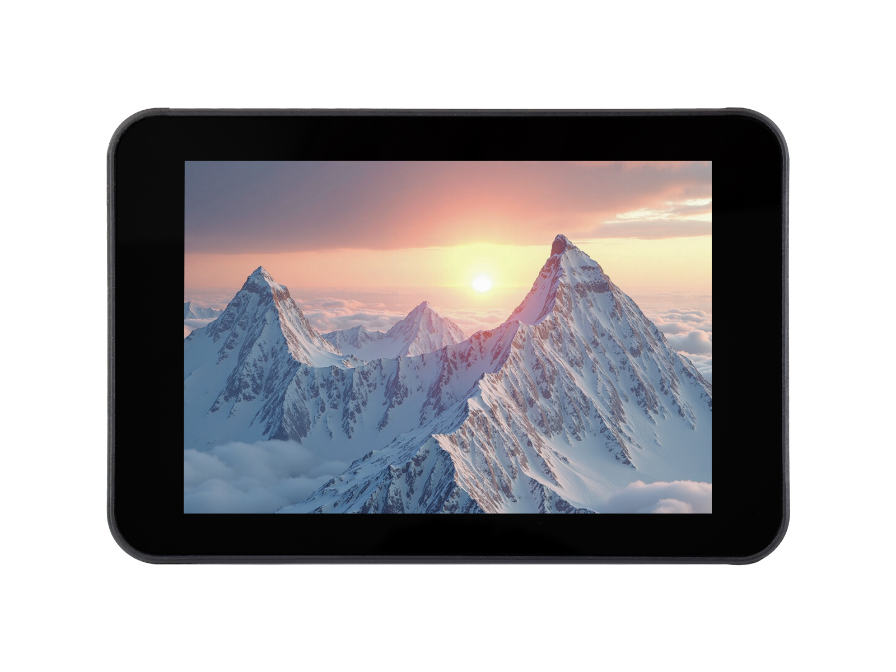
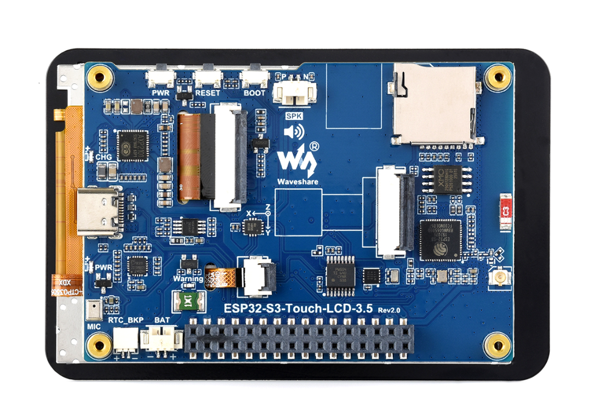

  <h1>ESP32-S3-Touch-LCD-3.5</h1>
  
<strong>ESP32-S3 3.5-inch 320 × 480 SPI IPS capacitive touch development board</strong>

  
<strong>English</strong> | <a href="README_ZH.md">简体中文</a>

  

    
    
    
  

  

    <a href="https://www.waveshare.net/shop/ESP32-S3-Touch-LCD-3.5.htm">🌐 Product</a> &middot;
    <a href="firmware/">📦 Firmware</a> &middot;
    <a href="examples/esp-idf/">🧩 ESP-IDF</a> &middot;
    <a href="examples/arduino/examples/">🔧 Arduino</a> &middot;
    <a href="hardware/schematic/">📚 Documentation</a>
  

  

  
<strong>ESP32-S3-Touch-LCD-3.5-C · With enclosure</strong>

  

  
<strong>ESP32-S3-Touch-LCD-3.5 · Without enclosure</strong>

---

## ✨ Overview

ESP32-S3-Touch-LCD-3.5 combines an ESP32-S3, a 3.5-inch IPS capacitive touch display, power management, a six-axis IMU, an RTC and an audio codec. This repository provides ESP-IDF and Arduino examples, factory firmware and schematics.

The product is available **with an enclosure** and **without an enclosure**. Both variants use the examples in this repository.

| Product variant | Enclosure | Camera | Product page |
| --- | --- | --- | --- |
| ESP32-S3-Touch-LCD-3.5 | Not included | Camera connector; module purchased separately | [Without enclosure](https://www.waveshare.net/shop/ESP32-S3-Touch-LCD-3.5.htm) |
| ESP32-S3-Touch-LCD-3.5-C | Included | OV5640 camera included | [With enclosure](https://www.waveshare.net/shop/ESP32-S3-Touch-LCD-3.5-C.htm) |

Enclosure variants are separate from V1/V2 PCB revisions: use the schematic matching the marking on your PCB.

| Feature | Device / interface |
| --- | --- |
| MCU | ESP32-S3, dual core, up to 240 MHz |
| Memory | 16 MB Flash, 8 MB PSRAM |
| Wireless | 2.4 GHz Wi-Fi and Bluetooth LE |
| Display | 3.5-inch 320 × 480 IPS LCD, ST7796 over SPI |
| Touch | FT6336 capacitive touch over I2C |
| Power management | AXP2101 |
| Motion sensor | QMI8658 six-axis IMU |
| Clock | PCF85063 RTC |
| Audio | ES8311 codec, microphone and speaker connector |
| Storage | microSD over 1-bit SD_MMC |
| Expansion / camera | TCA9554 I/O expander; OV5640-compatible camera connector |

## 📦 Quick Start

1. Download the factory merged image from [firmware](firmware/), or choose an available example `*-combined.zip` package from [Releases](https://github.com/waveshareteam/ESP32-S3-Touch-LCD-3.5/releases).
2. Connect the board with a USB data cable and install esptool: `python -m pip install esptool`.
3. Flash factory firmware at `0x0` using the [firmware instructions](firmware/README.md). For an example ZIP, extract it and run `flash_combined.bat COMx` on Windows or `./flash_combined.sh /dev/ttyACM0` on Linux.
4. Reset the board and prepare the SD card, speaker or camera described by the selected example.
5. To modify the program, choose an example below and build from its directory.

The latest factory merged image is available in [firmware/](firmware/). Current source is in [examples/factory/](examples/factory/); legacy source is retained in [01_factory](examples/esp-idf/01_factory/) for reference.

## 🧪 Examples

### ESP-IDF

| Example | Main feature |
| --- | --- |
| [01_factory](examples/esp-idf/01_factory/) | Legacy LVGL 8 factory demonstration |
| [02_lvgl_example](examples/esp-idf/02_lvgl_example/) | LVGL widgets and touch |
| [03_lvgl_system](examples/esp-idf/03_lvgl_system/) | System information, RTC and audio controls |
| [04_lvgl_qmi8658](examples/esp-idf/04_lvgl_qmi8658/) | QMI8658 motion display |
| [05_lvgl_axp2101](examples/esp-idf/05_lvgl_axp2101/) | AXP2101 power telemetry |
| [06_lvgl_camera](examples/esp-idf/06_lvgl_camera/) | Camera preview |
| [07_lvgl_wifi](examples/esp-idf/07_lvgl_wifi/) | Wi-Fi connection and scan UI |
| [08_lvgl_image](examples/esp-idf/08_lvgl_image/) | SD-card image viewer |

### Arduino

| Example | Main feature |
| --- | --- |
| [01_audio_out](examples/arduino/examples/01_audio_out/) | SD MP3 playback |
| [02_axp2101_example](examples/arduino/examples/02_axp2101_example/) | Power-management test |
| [03_camera_web_server](examples/arduino/examples/03_camera_web_server/) | Camera web server |
| [04_es8311_example](examples/arduino/examples/04_es8311_example/) | Microphone record and replay |
| [05_pcf85063_time](examples/arduino/examples/05_pcf85063_time/) | RTC serial output |
| [06_qmi8658_getdata](examples/arduino/examples/06_qmi8658_getdata/) | Motion-sensor serial output |
| [07_sd_card_test](examples/arduino/examples/07_sd_card_test/) | microSD file operations |
| [08_gfx_helloworld](examples/arduino/examples/08_gfx_helloworld/) | GFX display test |
| [09_gfx_jpeg](examples/arduino/examples/09_gfx_jpeg/) | JPEG decoding |
| [10_gfx_png](examples/arduino/examples/10_gfx_png/) | PNG decoding |
| [11_lvgl_arduino_v8](examples/arduino/examples/11_lvgl_arduino_v8/) | LVGL 8 touch controls |
| [12_lvgl_pcf85063](examples/arduino/examples/12_lvgl_pcf85063/) | RTC display |
| [13_lvgl_qmi8658](examples/arduino/examples/13_lvgl_qmi8658/) | Motion-sensor display |
| [14_lvgl_image](examples/arduino/examples/14_lvgl_image/) | LVGL SD image display |

The sketches share the [bundled libraries](examples/arduino/libraries/). Keep each LVGL sketch's own `lv_conf.h`: the image example uses different image-decoder and color settings.

### Factory demonstration

[factory](examples/factory/) provides 12 applications: Settings, AIChats, Touch Test, Photos, Weather, Music, Sensor, 2048, Camera, Mic Test, Button Test and Display Test. For Wi-Fi setup and application controls, see the [user guide](examples/factory/USER_GUIDE.md).

## 🛠️ Development Environment

| Framework | Configured version | Examples |
| --- | --- | ---: |
| ESP-IDF | `v5.5.4` | 8 |
| ESP-IDF (factory project) | `v5.5.4` | 1 |
| Arduino-ESP32 | `3.3.11` | 14 |

Framework versions and the full FQBN are defined in [.github/product.json](.github/product.json). The individual peripheral examples and legacy demonstration use **LVGL 8.4**; the current factory desktop uses **LVGL 9.6** with independent dependencies.

In Arduino IDE select **ESP32S3 Dev Module**, Flash **16MB**, PSRAM **OPI PSRAM**, Flash Mode **QIO**, Partition Scheme **16M Flash (3MB APP/9.9MB FATFS)**, USB Mode **Hardware CDC and JTAG**, and USB CDC On Boot **Enabled**. Make the bundled libraries available in your sketchbook's `libraries` directory, then open the selected `.ino`.

For ESP-IDF, activate the tool environment, enter the selected example directory, and run `idf.py set-target esp32s3`, `idf.py build`, then `idf.py -p PORT flash monitor`. The first build downloads managed dependencies declared by the project.

## 📚 Resources

- [V1 schematic](hardware/schematic/ESP32-S3-Touch-LCD-3.5-V1-Schematic.pdf)
- [V2 schematic](hardware/schematic/ESP32-S3-Touch-LCD-3.5-V2-Schematic.pdf)
- [Product without enclosure](https://www.waveshare.net/shop/ESP32-S3-Touch-LCD-3.5.htm)
- [Product with enclosure](https://www.waveshare.net/shop/ESP32-S3-Touch-LCD-3.5-C.htm)
- [Wiki](https://docs.waveshare.com/ESP32-S3-Touch-LCD-3.5/)

## 🤝 Support

- Example or repository problems: [open an issue](https://github.com/waveshareteam/ESP32-S3-Touch-LCD-3.5/issues/new).
- Product usage, hardware or order questions: [Waveshare support](https://service.waveshare.com/).

## 📄 License

[Apache License 2.0](LICENSE); bundled third-party components retain their own licenses and copyright notices.
